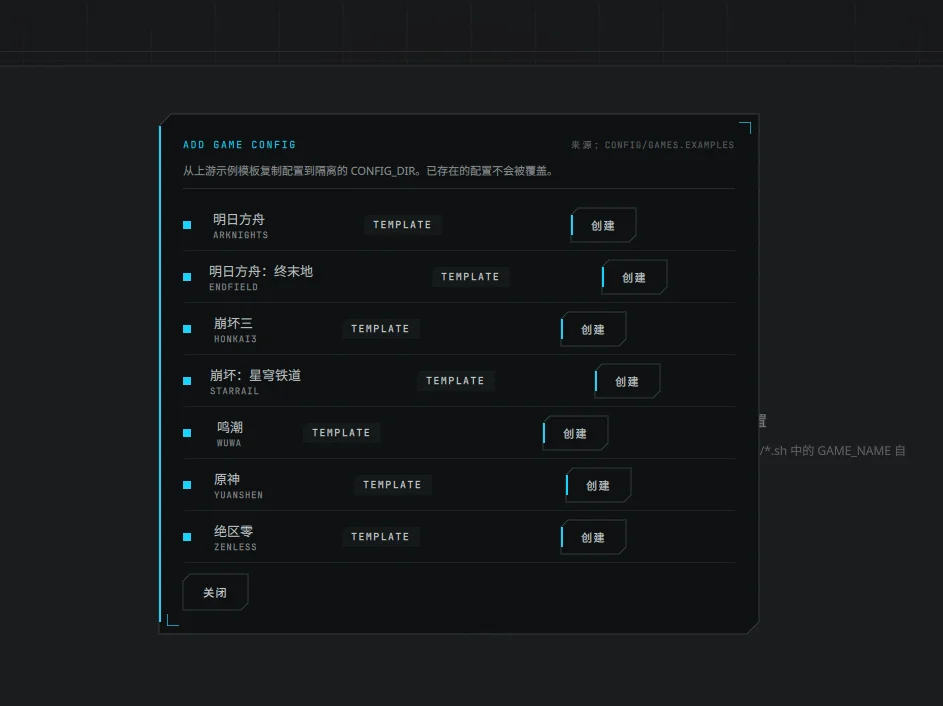
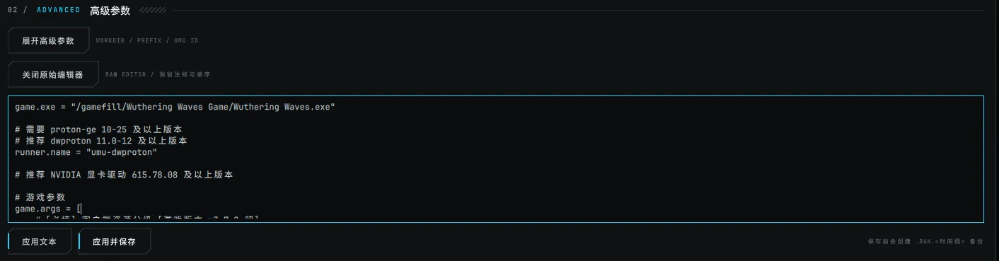

13:11，我把一份 8,653 字的任务书发了过去。

14:49，最后一版发完。中间 9 轮对话，389 次工具调用，15 个 commit，8 个 release。这 98 分钟里我总共只说了 22 句话，合计 454 字。

22 条里 16 条在抠界面、文案和文档，1 条补功能，0 条要求改架构。

这组数字跟「AI 会不会写代码」关系不大。它说明的是，边界写清楚之后，返工就不会落在架构上。项目本身的技术细节在[另一篇](/posts/hyps-hub/)里，这篇只讲怎么下指令、怎么验收。

## 数字

| 项目 | 结果 |
| --- | --- |
| 任务书 | 8,653 字，一次给出 |
| 后续指令 | 22 条，454 字，平均 20.6 字 |
| 其中带截图 | 4 条 |
| 时长 | 98 分钟 |
| 轮次 / 工具调用 | 9 / 389 |
| 提交 / 发布 | 15 / 8（v0.1.0 → v0.1.7） |
| 架构返工 | 0 |

表格最后一行是 0。倒不是因为它多懂架构，该写死的东西在第一份文件里就写死了，后面没留下「要不要重写」的空间。

## 22 条短句，16 条在抠细节

| 类别 | 条数 | 原话 |
| --- | --- | --- |
| 催进度、查环境 | 3 | 「继续啊」「任务跟踪怎么没了」 |
| 给设计参考 | 2 | 「等会界面设计遵循」（附两份 md） |
| 视觉 bug | 5 | 「为什么实际操作区域只有那么一点点」「界面怎么这么乱，不是对齐的」 |
| 文案与术语 | 3 | 「改 Hyps 副本为 Hyps 组件」「只描述为独立组件」 |
| 功能缺失 | 1 | 「怎么没有关于页」 |
| 发布与文档 | 4 | 「readme 的教程要展示所有关键页面的截图」 |
| 鸣谢 | 4 | 「为啥鸣谢我自己」 |

这些话平均 20 个字，短得离谱，但大半都能直接落成一个 commit。原因不复杂，**上下文已经在任务书里了**。说「不对齐」的时候，不需要再解释这个项目用 Ark 设计语言、0 圆角、固定列；说「副本改组件」的时候，也不需要解释内部目录结构不用动。

还有个细节。22 条里写明具体做法的只有两三条（「点击编辑按钮应该弹出一个大的编辑器窗口」「放在最下面」），其余更像验收口吻，报现象、给结论、不给做法。这跟省事无关，是分工。方案由实现方给，方向和判断由人给。人只说「这样不对」，比说「你应该改成这样」更有效，也更少返工。

## 任务书里真正起作用的九条

功能列表谁都会写，AI 也不会漏。真正把返工挡在门外的是下面这些「不许做什么」。

### 1. 受保护目录 + 破坏性操作红名单

目标仓库是日常在用的那个，红线是逐条列的。不改配置、不删文件、不 `reset --hard`、不 `clean`、不切分支、不 `pull`、不往里写 GUI 的数据。

没有这条，最常见的失控方式是「顺手帮你把配置改了」，改完还告诉你改好了。

### 2. 先调研再选型，选型要留决策记录

要求先读上游源码、确认真实能力，再在 Qt / GTK / 其他之间做比较，输出决策记录。最后选了 Qt 6 + QML，理由是 Wayland 支持、`QProcess` 的子进程管理、Arch 打包成本、依赖体积，每一条都能追溯。缺了这条，结果大概率是一个 Electron 壳，一个启动器背着一百多兆运行时，Wayland 下还多一层不确定性。

### 3. 事实只能来自源码

原话是「禁止凭空臆造命令参数、配置项和功能」「不确定时先检查源码和文档，不得猜测」。

这条挡掉的是最伤的一类错误，那种看起来对、跑起来报错的命令。GUI 调用 CLI，参数错一个，用户看到的往往只是一句看不懂的报错。

### 4. 能力边界，上游没有的不许假装有

上游没有游戏库扫描、没有自动下载安装，任务书直接把话写死，「不得通过虚构数据模拟功能已完成」。

于是界面里没有那些灰着的假按钮，也没有「即将支持」。少几个格子，比多一排点了没反应的按钮体面。

### 5. 安全红线

参数数组、不经 shell、不 root、不 `curl | sh`、不把用户输入拼进 `sh -c`。这条同时是安全要求和可测试性要求，参数是数组，测试里才能断言「传进去的到底是什么」。

### 6. 更新与恢复策略

首次克隆、日常不自动更新、脏工作区拒绝更新、只做快进合并、不删运行副本、克隆失败只清理自己创建的临时目录。

「自动更新」四个字，能写出十种丢数据的姿势。把策略提前写死，后面就只剩实现。

### 7. 可执行的验收条件

能构建、能启动、能初始化独立副本、能执行至少一项真实核心任务、原有仓库的 `git status` 仍为空。

验收条件必须能跑。写成「体验流畅」「界面美观」，等于没写。

### 8. 分阶段，每阶段实际构建

五个阶段，每阶段结束要汇报完成内容、构建和测试结果、已知问题、下一阶段计划。末尾还补了一句，「阶段汇报不得代替实际开发」。

这句很关键。否则你很可能收到五份漂亮的规划文档和零行能跑的代码。

### 9. 反作弊条款

不要用模拟界面冒充真实功能、不要留大量无效按钮、不要因为一次构建失败就停。三句话对应三种典型偷懒，尤其是第一条，画一个进度条骗过验收，成本比真实现低得多。

## 任务书管不到的三件事

### 像素

`ctest` 9/9 通过的那一版，弹窗里的状态标签和按钮是歪的，编辑器只能看到三行半。



*943×706 的截图。七个游戏的 `TEMPLATE` 标签和「创建」按钮逐行右移，越往下越歪。*



*1412×369 的截图。编辑器只露出三行半，`game.args = [` 后面直接被切掉，滚轮无效。*

弹窗那张截图我发过两次，第一次只问「这对吗」，第二次才说明白「界面怎么这么乱，不是对齐的」。

单测测不了「这个按钮比上面那个右移了一截」，也测不了「滚轮没反应」。两条都在十分钟内修完，但发现它们只能靠人看一眼截图说「不对」。

### 语气和语义

「只描述为独立组件」不是 bug，是产品语义。组件是软件的一部分，副本听起来像临时拷贝。AI 不会主动做这种取舍，它默认沿用你之前的说法。

反过来的例子是「为啥鸣谢我自己」。它自己加了一条致谢，写着「设计规范，K-Black 提供 docs/design/…」。AI 倾向于补全礼貌性的东西，哪怕你没要求。这条后来从关于页删掉，只保留公开参考和上游作者。

### 版权

我提议直接去明日方舟官网拿美术资源，它拒绝了。理由是这个项目 GPL 开源、要发布 PKGBUILD，内嵌官方立绘和图标有版权风险，建议改用原创几何标记加自生成纹理。

这次是它替我守住了边界。所以判断不全由人做，但方向得人给。

## 三次节奏问题

1. **一问一答打断执行流。** 中途问了一句技术栈（Qt 还是别的、走什么窗口 API），它停下来解释了一轮 Qt/QML 与平台插件。任务书里写了「不要只生成方案就停止」，但提问本身就会把执行切成两段。第二句「继续啊」才把它拉回来。
2. **进度不可见。** 第二轮开始时任务列表没显示出来，一句「任务跟踪怎么没了」，它才重新写了一遍。长任务里，看不见进度等于失控。
3. **上下文会衰减。** 98 分钟后，会话开始折叠早期内容，一次折掉约 2.8 万 token。后半程它靠的基本是仓库里的文件、文档和截图。记忆那部分，早折没了。

第 3 条决定了这套流程的适用长度。半天到一天的工作量，靠文件系统当记忆够用；再长就该拆会话、按阶段交接。

## 一份可复用的骨架

把这次的任务书抽干水分，结构大概是这样。

```text
0  项目定位与上游（是什么、不是什么、上游在哪）
1  受保护资产 + 破坏性操作红名单
2  技术选型（候选、比较维度、决策记录）
3  事实来源（先读源码，禁止臆造）
4  能力边界（上游没有的不许假装有）
5  安全红线（调用方式、权限、网络、日志脱敏）
6  更新与恢复（谁能改、改坏了怎么退）
7  验收条件（可执行、可验证、失败怎么判定）
8  阶段计划（每阶段构建 + 汇报格式）
9  禁止事项（模拟功能、空壳按钮、破坏性操作、自作主张）
```

重点不在篇幅。每一条都能对应一种具体的失败方式。除了功能清单和界面要求，8,653 字里的约束条款几乎都在回答「不许出哪种错」。

## 什么时候这套不管用

- **没有明确上游的时候。** 任务书会退化成需求文档，这时该先做调研，再写任务书。
- **视觉方向。** 写不进任务书，只能给参考物。这次是两份现成的设计规范 md，然后人对着截图验收。
- **创意和取舍。** 术语、文案、版权、产品语义，这些外包不出去。
- **更长的工程。** 上下文折叠之后，跨会话的一致性要靠文档和交接，而不是「记得」。

## 最后

8 个 release、15 个 commit、0 次架构返工。所有返工都在像素层，而且大部分是一句话的事。

我的结论没那么大，**把不该动的写死，剩下的用眼睛验收**。任务书负责不犯错，人负责不难看。
