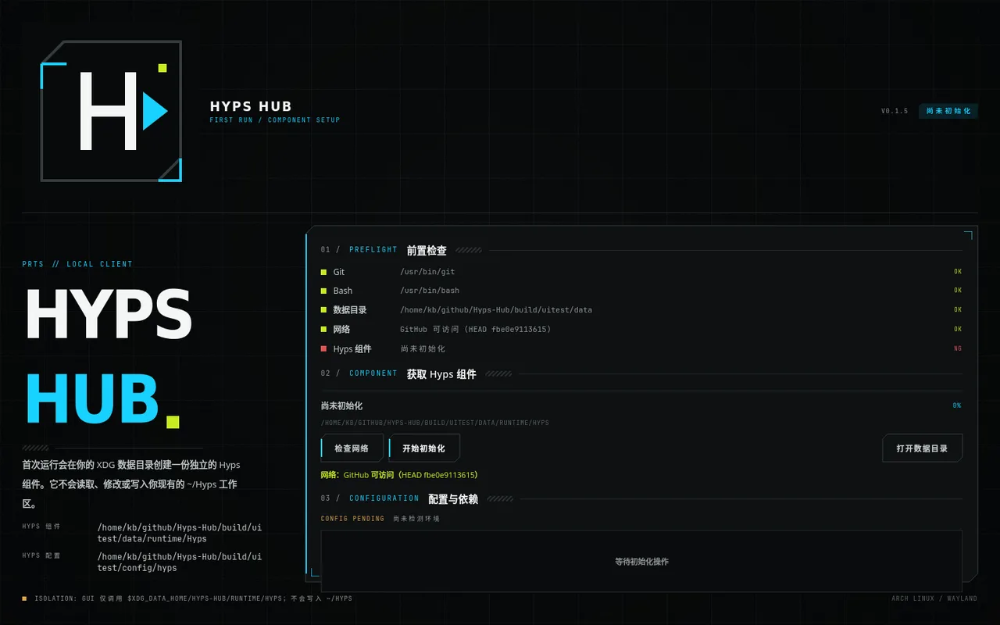
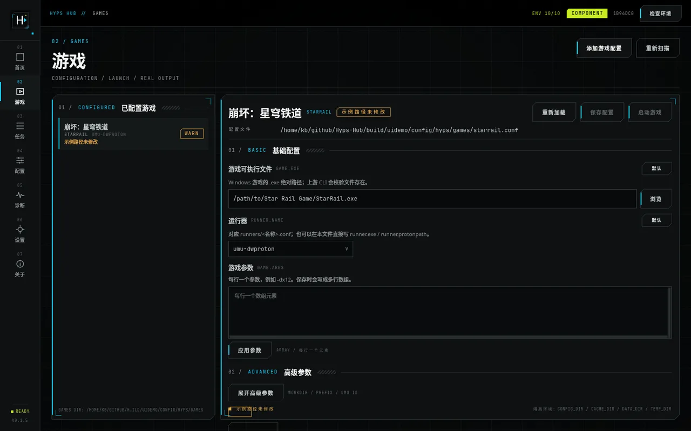
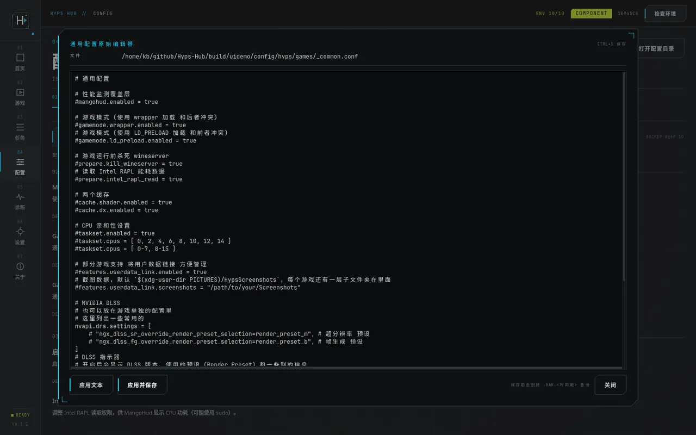
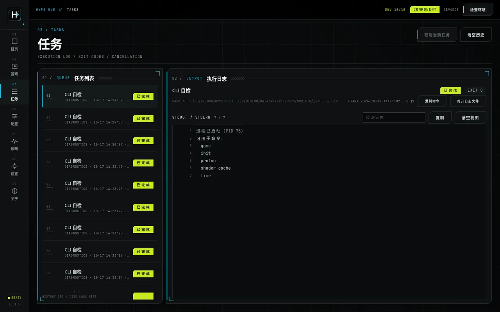
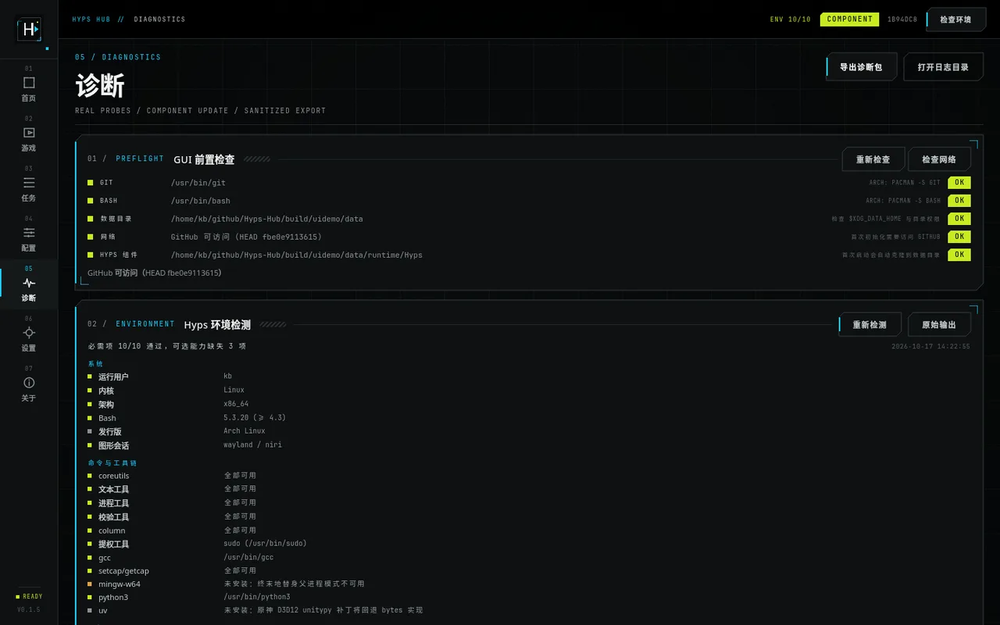
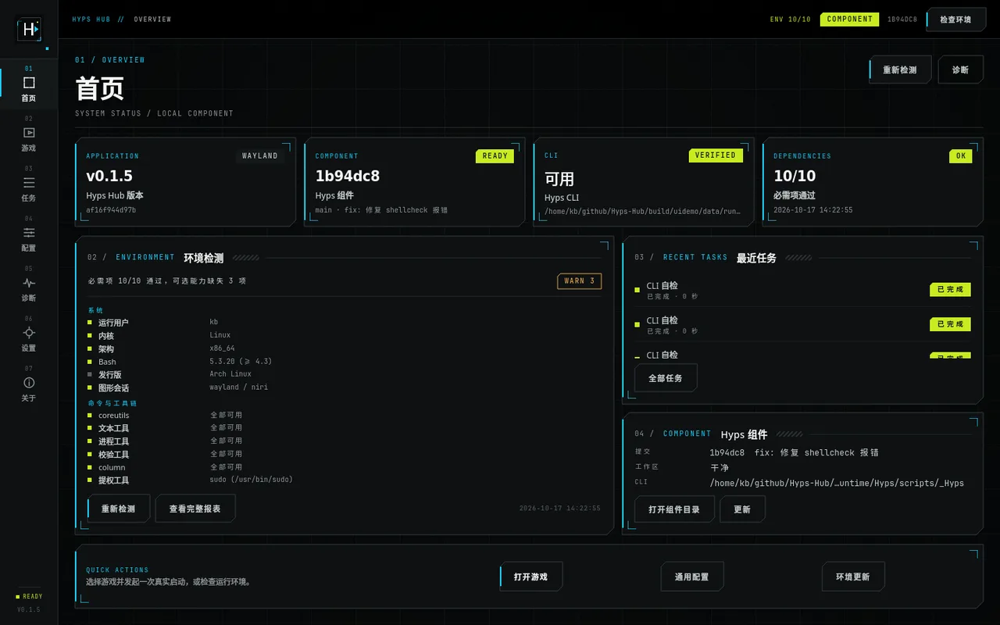

[Hyps](https://github.com/MoYingJi/Hyps) 是一个 Bash 脚本集合，用来在 Linux 上跑几款游戏，比如崩坏三、原神、星穹铁道、绝区零、鸣潮、明日方舟 PC、终末地。作者自己在 README 里写「铲屎山中」，说当初没想到屎山会堆这么高，正在计划重构。这很诚实，也基本决定了任何想给它做界面的人该怎么做。

它的日常用法是这样的。去 `config/games/` 找 `_common.example.conf`，复制成 `_common.conf`，改一堆路径；再挑一个 `<game>.example.conf`，复制、改名、填 `game.exe`、选 `runner.name`、按需打开 MangoHud / GameMode / Overlay / taskset；最后运行 `scripts/<Game>.sh`。跑起来之后，日志、退出码、报错全在终端里往上滚。

这套流程我用了很久。它跑不跑得起来倒不是问题。麻烦的是每改一次配置都像手工排雷。键名记不住、路径带空格就炸、注释被手滑删掉、哪个开关是开着的完全靠翻文件。

所以有了 [Hyps Hub](https://github.com/K-Blaaaack/Hyps-Hub)，一个 Qt 6 / QML 的原生 Linux 客户端，把这套操作搬到图形界面里。

先说明一下，这个项目的代码是 AI 写的，这篇稿子也是它整理的。我负责给任务书、划边界、看截图验收、决定发布。过程写在[另一篇](/posts/ai-dev-brief/)里，这篇只讲项目本身。



*首次启动进入独立的初始化向导，检查 Git、Bash、数据目录与网络，异步克隆上游组件，实时显示进度。*

## 上游是一个脚本集合，不是一个程序

动手之前先读了一遍上游源码，结论直接决定了架构。

- **没有机器接口。** 没有 JSON、没有 `--format`，`init.sh --check` 是唯一结构稳定、值得解析的输出。
- **没有 `game start`。** 启动游戏的唯一真实入口就是 `scripts/<Game>.sh`，脚本内部靠 `GAME_NAME` 决定跑哪个游戏。
- **日志走 stderr，数据走 stdout。** 颜色只在 stderr 是 TTY 时才输出（`use_color()` 检查 `-t 2`），所以管道方式调用拿到的是纯文本。
- **缺能力。** 没有游戏库扫描、没有自动下载安装游戏或 Proton、没有版本管理。上游明确说「只是启动脚本，远达不到启动器的要求」。

把这些列出来，答案就清楚了。**不要重写启动逻辑**。上游已经把这些游戏的启动细节踩了无数遍，umu、Proton、prefix、overlay、DXVK 缓存、注册表补丁、Hosts，一个都没落下。GUI 该做的是外面那一层，检查、调用、展示、编辑配置。

## 先划边界

Hyps Hub 只做四件事。

1. 判断环境够不够跑（Git、Bash、网络、依赖）。
2. 把上游组件装到一个隔离的位置，并保持它可以安全更新。
3. 调用上游的脚本，把 stdout / stderr / 退出码如实搬进界面。
4. 把 `.conf` 变成表单，但写回去的文件仍然是人能读、能 git diff、能继续手改的原文。

不做的事也一样清楚。不假装有游戏库，不假装能下 Proton，不提供任意命令执行器，不提供「直接用 `~/Hyps` 当组件」这种隐式行为。**「不实现」比「实现一半」安全得多**，尤其当你面对的是一个随时会重构的上游。



*游戏页，左侧是 `CONFIG_DIR/games/*.conf` 里的已配置游戏，右侧把 `game.exe`、`runner.name`、`game.args` 变成表单。只有配置完整且已保存，「启动游戏」才可用。*

## 三条硬约束

这大概是整个项目里最费心思的部分。目标写在 README 第一段。GUI 与 CLI 解耦，运行环境独立，数据隔离。落到实现上是三件事。

### 组件独立

上游组件被克隆到自己的 XDG 数据目录，不是你家目录下那个手改过的 `~/Hyps`。

```
$XDG_DATA_HOME/hyps-hub/runtime/Hyps
```

首次初始化时先检查 `git` / `bash`，用 `git ls-remote` 做只读的网络探测（20 秒超时），然后克隆到 `runtime/.Hyps.clone-<pid>-<时间戳>` 这样的临时目录，解析进度，成功后再原子改名成 `Hyps`。任何一步失败只清理本次创建的临时目录；目标已存在时先校验，绝不覆盖。

这样做的收益不只是「干净」。因为组件不是你的工作目录，它就不会带着你三个月前手改的改动，于是它才能被安全地更新。

### 环境注入，四个变量

上游 `lib/config.sh` 里有这么四行。

```bash
config_read_realpath_prefer_env path.config CONFIG_DIR "${XDG_CONFIG_HOME:-$HOME/.config}/hypsc"
config_read_realpath_prefer_env path.cache  CACHE_DIR  "${XDG_CACHE_HOME:-$HOME/.cache}/hypsc"
config_read_realpath_prefer_env path.data   DATA_DIR   "${XDG_DATA_HOME:-$HOME/.local/share}/hypsc"
config_read_realpath_prefer_env path.temp   TEMP_DIR   "/tmp/hypsc"
```

关键在于这个函数的行为，目标变量**已非空时直接采用该值**。也就是说，只要在启动子进程时注入这四个变量，Hyps 的配置、缓存、prefix、overlay、时长记录、临时目录就全部被重定向，完全不写组件工作区，也不会和你自己的 `~/.config/hypsc` 混在一起。

于是每次调用 CLI 都带上固定的隔离环境。

```bash
CONFIG_DIR="$XDG_CONFIG_HOME/hyps-hub/hyps"
CACHE_DIR="$XDG_DATA_HOME/hyps-hub/cache/hyps"
DATA_DIR="$XDG_DATA_HOME/hyps-hub/hyps-data"
TEMP_DIR="$XDG_DATA_HOME/hyps-hub/cache/hyps-tmp"
NO_COLOR=1
```

`NO_COLOR=1` 是双保险，反正管道下本来就不出颜色。

四个目录变量的优先级、`runner.exe` 可以省略、`runner.protonpath` 能推导出默认值，这些行为都写进了适配层的契约里。它们不能由 GUI 自己发挥，上游一旦变了，字段校验和调用方式就得跟着变。所以适配层是唯一需要跟着上游走的地方。

### 配置分离

GUI 自己的配置和 Hyps 的配置是两套东西，物理上分开。

| 路径 | 内容 |
| --- | --- |
| `$XDG_DATA_HOME/hyps-hub/runtime/Hyps` | 独立 Hyps 组件（Git 仓库） |
| `$XDG_CONFIG_HOME/hyps-hub/config.json` | GUI 自身配置，含主题、窗口、偏好 |
| `$XDG_CONFIG_HOME/hyps-hub/hyps/games/*.conf` | 注入给 CLI 的 `CONFIG_DIR` |
| `$XDG_STATE_HOME/hyps-hub/tasks.jsonl` | 任务历史，最多 200 条 |

卸载应用不会删组件、配置和日志。这是故意设计的，因为删掉一个跑得起来的游戏环境属于不可接受的副作用。要彻底清理就手动删目录，README 里写了清单。

## 安全边界写进代码，不是写进文档

「不经过 shell」这句话如果不落在代码结构上，迟早会有人图方便拼一个字符串。所以界面上不存在任何命令输入框，所有外部调用都收口在两个对象上。

- `HypsAdapter` 负责调用 CLI 和启动游戏。
- `RuntimeManager` 负责所有 Git 操作。

`ProcessRunner` 里只有 `setProgram` + `setArguments`，没有 `shell=true` 这个选项。具体动作是一张白名单表。

| 动作 | 程序 | 参数 |
| --- | --- | --- |
| CLI 自检 | `bash` | `<runtime>/scripts/_Hyps --help` |
| 环境检测 | `bash` | `<runtime>/init.sh --check` |
| 初始化配置 | `bash` | `<runtime>/init.sh --no-game` |
| 创建游戏配置 | `bash` | `<runtime>/init.sh <slug>` |
| 启动游戏 | `bash` | `<runtime>/scripts/<Game>.sh` |
| 诊断命令 | `bash` | `game list` / `proton list` / `time list` / `--help` |

诊断页也只开放这四条只读命令，没有「自定义命令」这种东西。

## 四个真正花时间的细节

界面本身写得比想象中快，麻烦都在边上。

### 1. 写回配置不能丢注释

`.conf` 是行式 INI 风格，上游的解析器支持注释、空行、`[section]`、引号、行内注释、多行的 `[ ]` / `( )` 数组。如果我把它读成键值对、改一个值、再整个序列化回去，注释和顺序就没了。偏偏注释里写着「这个开关默认关，需要时打开」。

所以 `ConfigFile` 的写回是**只重写目标行**，其余每一行按原文保留。保存流程是先写 `.bak.<时间戳>`（最多留 10 个），再用 `QSaveFile` 原子替换；未识别的键原样保留，只折叠在「原始编辑器」里。高级模式允许直接改全文，但应用前会完整解析一遍，解析不过就不落盘。



*原始编辑器是独立大窗口，双向滚动、`Ctrl+S` 保存。「应用」只进内存，「应用并保存」才校验、备份、落盘。*

### 2. 不要硬编码启动脚本名

上游的启动脚本在 `scripts/*.sh`，但文件名不保证等于配置里的 slug。正确的做法是解析脚本内容里的 `GAME_NAME="<slug>"`，和上游 `init_find_launcher_script` 用同一套规则。这样上游哪天改了文件名，GUI 不会跟着瞎。

### 3. 取消一个游戏，不只是 kill

`umu-run` 会 fork 出 Proton、wine server 和游戏本体。只杀父进程，留下的是没退干净的 wine 进程和下一次启动时的报错。所以 `ProcessRunner` 在 Unix 下用 `setChildProcessModifier` 调 `setpgid(0, 0)` 建立独立进程组，取消时先 `SIGTERM` 整个进程组，1.5 秒后再 `SIGKILL`。窗口关闭和 `aboutToQuit` 走同一条路径，最多等 3 秒。

日志采集也是一样，stdout / stderr 分通道，用 `QStringDecoder` 增量解码 UTF-8，不假设固定行格式。上游的报错里既有中文也有 ANSI 转义。



*任务页，左侧状态、耗时、退出码，右侧实时输出。取消按进程组终止，历史最多 200 条，每个任务的完整日志落在 `logs/tasks/`。*

### 4. 更新只做快进合并

一个会自己更新的 GUI，最容易写出的 bug 是「帮用户把改动清理掉」。这里的规则是死的。

1. `git status --porcelain` 非空 → 直接拒绝更新，并说明原因。
2. `git fetch --prune origin`，只更新远程引用。
3. 展示当前提交 / 上游提交 / 提交主题，等用户确认。
4. `git merge --ff-only origin/<branch>`。

从头到尾没有 `reset --hard`、没有 `clean`、没有 `checkout` 覆盖用户修改。更新前后提交写进 `update-history.jsonl` 和运行日志，失败时给的是可执行的恢复建议，不是一句「更新失败」。



*诊断页，前置检查、真实环境报表、组件更新状态、白名单命令，以及脱敏诊断包导出。*

## 界面只借设计语言

视觉上参考的是明日方舟那套界面语法，近黑墨底、单一青色信号、0 圆角、1px 细线、45° 切角、`NN` 索引、噪点与警戒线纹理。左侧导航用两位数字编号，右侧内容区按「01 / 02」分组，标题配一行极小的等宽副标题。

但它只借语法，不借资产。没有鹰角网络的商标、logo、立绘、图标表或字体文件，字体只用系统本地回退，logo 和导航图标是自绘的，纹理由脚本生成。这份克制也写进了项目文档，设计语言可以移植，美术资产不行。



*首页，四张状态卡、真实 `init.sh --check` 报表、最近任务、组件提交与 CLI 入口。*

主题跟随系统 `QStyleHints::colorScheme`，也可以手动锁定深色或浅色，切换时保持同一套令牌和零圆角几何。

选 Qt 6 而不是 Electron / Tauri，理由很实际。`QProcess` 的进程组、分通道读取、环境变量注入都是现成的，CMake + Ninja + Arch 打包也是熟路；反过来，为了一个启动器背一套浏览器运行时，在 Wayland 的游戏环境里只会多一层不确定性。

## 测试

GUI 项目的测试容易变成「点一遍看看」。这里能自动化的一部分尽量自动化了，`ctest` 9/9 通过。

- `tst_apppaths`，验证 XDG 解析与测试用环境覆盖。
- `tst_configfile`，拿上游示例配置当 fixture，测解析、往返、编辑、备份、损坏输入。
- `tst_environmentreport`，喂真实 `--check` 输出，加上 ANSI 与异常变体。
- `tst_processrunner`，覆盖 stdout / stderr、退出码、超时、取消、路径带空格、非 UTF-8、参数不经 shell。
- `tst_runtimemanager`，注入假 `git`，验证克隆失败清理、目标存在不覆盖、脏工作区拒绝更新、ff-only 更新。
- `tst_hypsadapter`，用假 Hyps 组件（bash 脚本模拟 CLI）校验参数数组与环境注入。
- `tst_gamecatalog` 和 `tst_diagnostics`，一个测游戏状态判定，一个测诊断包脱敏。
- `tst_smoke`，offscreen 下真实加载全部 QML，验证无警告、能退出。

网络端到端测试默认禁用，设 `HYPS_HUB_RUN_NETWORK_TESTS=1` 才会真的从 GitHub 克隆、跑 `init.sh --no-game` 和 `init.sh --check`。跑通时必需项 10/10，用的全是临时目录，不碰真实配置。

至于「能不能启动游戏」，自动化测不了，也没打算假装测了。测试用的是假组件和假 `git`，真机启动是人工验证的。

## 构建与安装

Arch 上依赖很少。

```bash
sudo pacman -S --needed base-devel cmake ninja qt6-base qt6-declarative qt6-svg
cmake -S . -B build -G Ninja -DCMAKE_BUILD_TYPE=Release -DBUILD_TESTING=ON
cmake --build build && ctest --test-dir build --output-on-failure
./build/hyps-hub
```

本地安装不用 root（`./scripts/install-local.sh`），或者用 `packaging/PKGBUILD` 打个包，成品约 378 KiB，安装后约 832 KiB。GitHub Actions 每次提交跑构建与测试，推一个 tag 就自动发 Release。框架是 C++20 + Qt 6 / Qt Quick Controls 2 自定义主题，没有拉 KDE Frameworks 或 Kirigami，GNOME、KDE、niri 下行为一致。

## 明确不做

- **不提供 Flatpak / AppImage。** 沙箱对宿主机 GPU 和游戏运行环境有实际限制，不做未验证的交付。
- **不做任意命令执行器。** 只有白名单诊断命令。
- **不虚构上游没有的能力。** 没有游戏库、没有自动安装、没有 Proton 下载。
- **不做多运行环境模板、配置导入导出。** 在上游重构之前做这些，等于给一个要拆的房子加阁楼。

现在的版本是 v0.1.7，GPL-3.0-only。上游也是 GPL-3.0-only，但这个项目不含它的源码。运行时由你自己机器上的独立组件提供。

## 最后

做完之后回头看，真正的技术含量在几条克制上。不碰 `~/Hyps`、不经过 shell、不破坏性更新、不丢注释、不假装有能力。

上游正在计划重构，README 上挂着「可能有较多的 breaking changes」。这是所有给别人的项目做客户端的人都要面对的现实，你控制不了上游。能做的只有把耦合面收窄到一个适配层里，让上游变了之后，要改的地方集中在一个适配层，而不是散在整个界面里。

如果你也在用 Hyps，欢迎试试；文档在 [`docs/`](https://github.com/K-Blaaaack/Hyps-Hub/tree/main/docs)，从架构、适配层契约到验收记录都写了。

特别鸣谢上游作者 [MoYingJi](https://github.com/MoYingJi)。CLI、初始化逻辑、配置格式和游戏启动的一切都是他踩出来的。这个项目只是在他垒好的东西外面，加了一层能点的壳。
